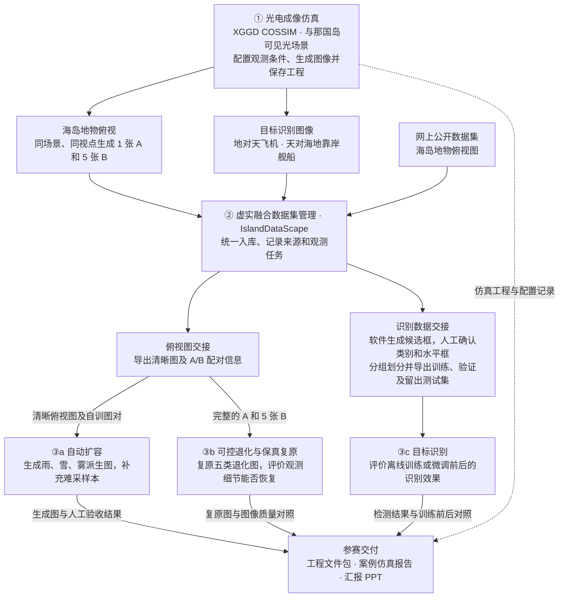
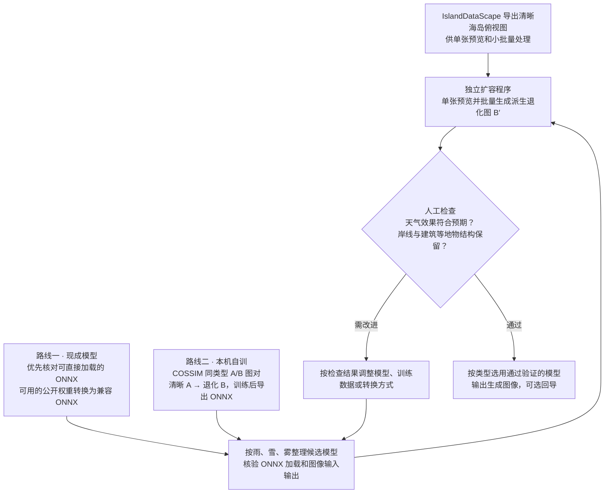
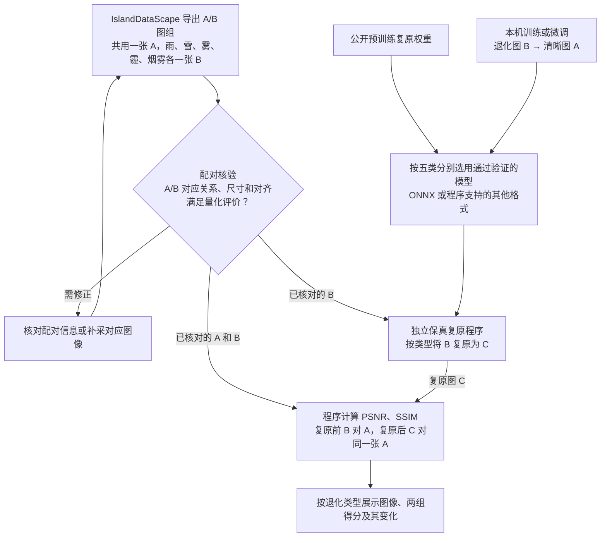
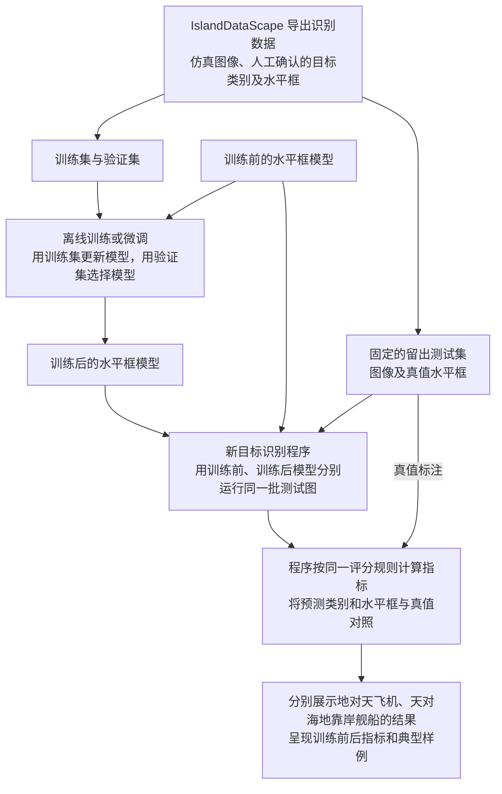

# 海岛数境——光电成像仿真、虚实融合数据集管理与智能应用验证

整理日期 2026-11-11。本文记录已确认的参赛需求、实施路线和验收方式。

## 1. 已确认需求

### 光电成像仿真

使用 **XGGD COSSIM** 在**与那国岛可见光场景**开展场景建模和仿真计算，保存工程与出图配置。本项目将性能评估和方案优化落在三个智能应用的验证中。

| 观测任务 | 仿真输出与用途 |
| --- | --- |
| 海岛地物俯视 | 同一场景、同一视点共用一张清晰基准图 A。雨、雪、雾、霾、烟雾干扰各生成一档退化图 B，形成 **1 张 A＋5 张 B**。清晰图可用于自动扩容，配对图用于训练或验证。 |
| 地对天飞机观测 | 生成地面对天空的仿真图像，供目标识别使用。 |
| 天对海地靠岸舰船观测 | 生成从空中观测海面和陆地的靠岸舰船仿真图像，供目标识别使用。 |

### 虚实融合数据集管理

- **数据来源**包括网上公开数据集和 COSSIM 仿真图像。公开数据集用于海岛地物俯视图像，两类识别任务使用对应的 COSSIM 图像。
- **IslandDataScape** 统一入库和登记来源，保存俯视图的 A/B 配对关系。识别样本采用半自动标注，软件生成候选框，人工确认目标类别和图像坐标中的二维水平框。
- **应用交接**通过导出的图像及对应清单完成。扩容程序读取清晰俯视图，复原程序读取 A/B 图组，识别训练和测试读取对应的图像及水平框标注。同源识别样本按序列分组划分训练集、验证集和留出测试集。

### 智能应用验证

| 独立程序 | 输入与输出 | 验收方式 |
| --- | --- | --- |
| **自动扩容** | 支持单张预览和批量读取 IslandDataScape 导出的一小批海岛地物俯视图，生成雨、雪、雾三类派生退化图 B′。生成图像可选回导 IslandDataScape。 | 人工检查雨、雪、雾效果，以及岸线、建筑等地物结构是否保留。 |
| **可控退化与保真复原** | 从 IslandDataScape 读取 A 和五类 B，按退化类型生成复原图 C。 | 程序直接计算并展示 B 对 A、C 对同一张 A 的 PSNR、SSIM，以及复原前后的变化。 |
| **目标识别** | 比赛版程序独立开发。地对天飞机和天对海地靠岸舰船的标注、训练、推理与验收均采用水平框。 | 在同一留出测试集上比较训练或微调前后的模型。由新程序根据同一套标注和评分规则直接计算、展示结果。 |

## 2. 技术路线

- **自动扩容**同时验证两条路线。优先检索可直接加载的 ONNX 模型，也可将作者的现成权重转换为兼容 ONNX。自训路线优先使用本机 Windows，利用 COSSIM 配对图以 A 为输入、B 为训练目标，训练后导出 ONNX。雨、雪、雾分别采用通过验收的模型，允许不同类型采用不同来源。
- **保真复原**按雨、雪、雾、霾、烟雾五类分别选用通过验证的模型。可采用公开预训练权重，也可用 COSSIM 图对在本机训练或微调，训练时以 B 为输入、A 为目标。模型可采用 ONNX 或程序支持的其他格式。程序推理时将 B 复原为 C，再用 A 作为共同参考。
- **目标识别**使用 IslandDataScape 导出的 YOLO 水平框数据，在独立环境用训练集和验证集训练或微调。新程序分别加载训练前后的水平框模型，对固定留出测试集推理，根据人工确认的真值框计算并展示对照结果。

## 3. 总流程框图

赛道任务和交付形式见 [中国光学工程学会赛事通知](https://www.csoe.org.cn/detail/2199.html)。

## 4. 自动扩容流程框图

## 5. 可控退化与保真复原流程框图

## 6. 目标识别流程框图

## 7. 待定项与未来展望

- **模型选型**以实际样例上的验收结果和运行环境兼容性为依据。
- **识别指标**暂列精确率、召回率、AP@0.5 为候选，具体必显项待确认。
- **未来展望**为红外波段下的识别退化。
